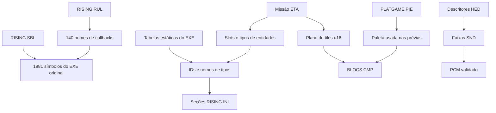

# Relações entre dados

Vínculo IDs↔nomes e callbacks↔símbolos comprovado. Paleta compartilhada para todos os estados continua com forte evidência, sem prova para cada transição de runtime. IDs de eventos e vídeos ainda precisam ligação comportamental.
